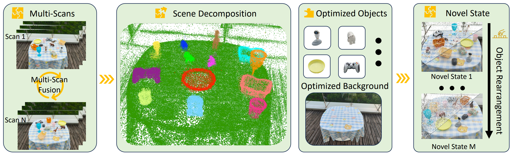
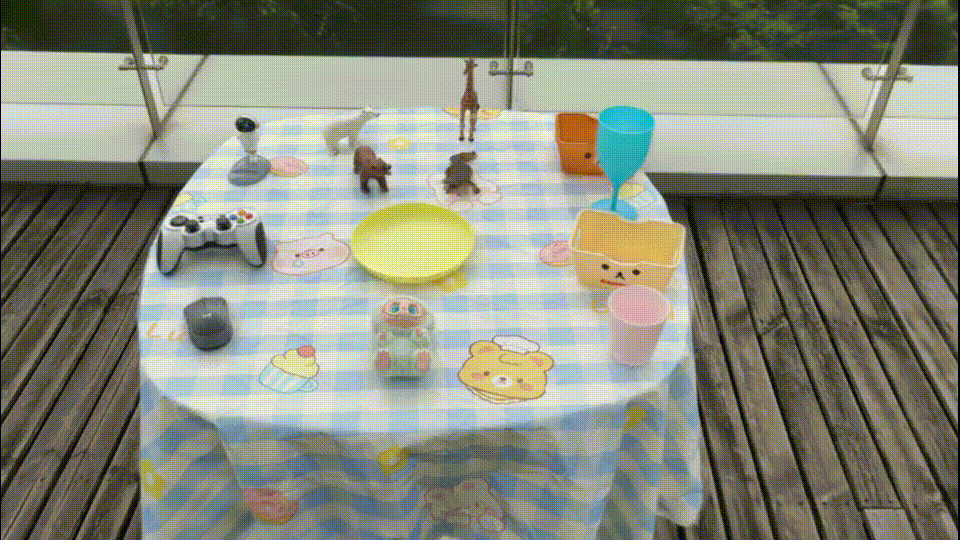
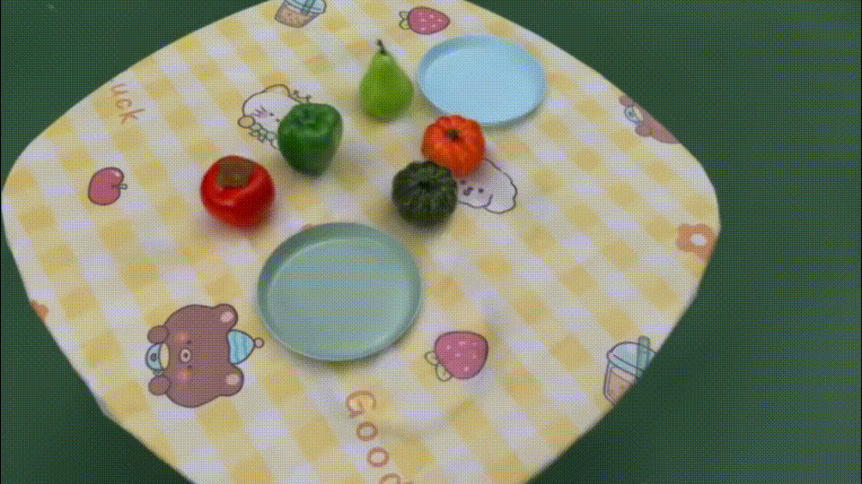
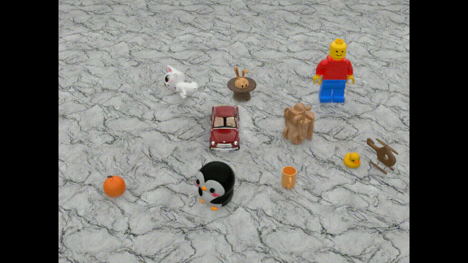

# IGFuse: Interactive 3D Gaussian Scene Reconstruction via Multi-Scans Fusion

<p align="center"><strong>AAAI 2026 Oral</strong></p>

[](https://whhu7.github.io/IGFuse/)
[](https://arxiv.org/abs/2508.13153)

<div align="center" style="background-color:white; padding:10px; display:inline-block;">
  
</div>

<p align="justify">
Given multiple observed scene scans, IGFuse performs multi-state optimization to jointly reconstruct an interactive Gaussian field with realistic rendering. The model learns object-aware 3D Gaussians that can be rearranged across observed layouts and generalize to unseen object poses via cross-state alignment and pseudo-layout supervision.
</p>

## 🎥 Demo Results

<p align="center">
  
  
  
</p>

---

## 🛠️ Installation

```bash
# Clone the repository
git clone https://github.com/whhu7/IGFuse-code
cd IGFuse-code

# Create the environment
conda create -n igfuse python=3.9 -y
conda activate igfuse
pip install -r requirements.txt

pip install submodules/diff-gaussian-rasterization
pip install submodules/simple-knn
```

---

## 📦 Dataset

Download the bundled scenes from [Google Drive](https://drive.google.com/file/d/1JMFPRrOaBoI2ipwHzPpCDivg-YBtt4CJ/view?usp=sharing) (`igfuse_datasets.tar.gz`, ~2.0 GB), then extract at the repository root:

```bash
tar -xzf igfuse_datasets.tar.gz
```

This creates `datasets/synthetic/` and `datasets/real/`. Each scene root looks like:

```text
scene_xxx/
├── train/
│   ├── state_000/                 # observed layout (cameras + object poses)
│   │   ├── images/
│   │   ├── masks/                 # PNG; 0=background, 1…K=objects
│   │   ├── objects_poses.json  # object poses; same key order everywhere
│   │   ├── gaussian/point_cloud.ply
│   │   ├── transforms_train.json  # synthetic cameras
│   │   ├── transforms_test.json   # synthetic cameras
│   │   └── colmap/                # real cameras
│   └── state_001/                 # … (≥2 observed layouts required)
├── test/
│   └── state_000/                 # held-out layout for evaluation
│       └── …                      # same as train state, except no gaussian/
└── pseudo/                        # optional; unseen layouts from pseudo_gen.py
    ├── objects_poses_0000.json
    └── …
```

**Conventions**

- **Cameras**: synthetic → `transforms_*.json`; real → `colmap/`. Do not mix both in one state folder.
- **Poses**: object key index `j` in JSON ↔ mask id `j + 1`; keep key order consistent across train/test/pseudo.

---

## 🚀 Workflow

Three shell scripts cover the full pipeline. Edit the variables at the top of each script, then run from anywhere.

### Generate pseudo layouts (optional)

Bundled datasets already include a `pseudo/` folder. Run this step only if you want to generate additional unseen layouts:

```bash
bash scripts/pseudo_gen.sh
```

Key variables in `scripts/pseudo_gen.sh`:

| Variable | Meaning |
|----------|---------|
| `DATASET_PATH` | Scene root with `train/state_*` |
| `NUM_PSEUDO` | Number of pseudo layouts to sample (default `100`) |
| `MIN_DISTANCE_RATIO` | Min XY spacing vs observed pair distance|
| `PADDING_RATIO` | Expand pseudo sampling bounds around observed layouts |

Output: `<dataset_path>/pseudo/objects_poses_XXXX.json`.  
If generation fails to find valid layouts, try reducing `MIN_DISTANCE_RATIO` or increasing `PADDING_RATIO`.  
If `pseudo/` is empty, training skips pseudo loss automatically.

### Train

```bash
bash scripts/train.sh
```

Key variables in `scripts/train.sh`:

| Variable | Meaning |
|----------|---------|
| `DATASET_PATH` | Scene root |
| `MODEL_PATH` | Output directory for checkpoints |

Checkpoints: `<MODEL_PATH>/point_cloud/iteration_*`.

### Render

Transform each trained state into a held-out test layout and evaluate:

```bash
bash scripts/render.sh
```

Key variables in `scripts/render.sh`:

| Variable | Meaning |
|----------|---------|
| `DATASET_PATH` | Scene root |
| `MODEL_PATH` | Trained output directory |
| `ITERATION` | Checkpoint iteration to load (default `20000`) |
| `TEST_STATE_INDEX` | Which `test/state_*` to render into (default `0`) |

Outputs: `<MODEL_PATH>/test_state_000/from_state_*` with RGB, segmentation, and `summary_metrics.json`.

---

## 📚 Citation

If you use IGFuse in your research or projects, please cite:

```bibtex
@inproceedings{hu2026igfuse,
  title={Igfuse: Interactive 3d gaussian scene reconstruction via multi-scans fusion},
  author={Hu, Wenhao and Li, Zesheng and Zhou, Haonan and Liu, Liu and Wen, Xuexiang and Su, Zhizhong and Li, Xi and Wang, Gaoang},
  booktitle={Proceedings of the AAAI Conference on Artificial Intelligence},
  volume={40},
  number={6},
  pages={4932--4940},
  year={2026}
}
```

---

## 🙏 Acknowledgements

This project is built on top of open-source Gaussian splatting research:

- **[3D Gaussian Splatting](https://github.com/graphdeco-inria/gaussian-splatting)** — real-time radiance-field rendering with 3D Gaussians.
- **[Gaussian Grouping](https://github.com/lkeab/gaussian-grouping)** — object-aware Gaussian segmentation and editing.

---

## ⚖️ License

Copyright (c) 2026 Wenhao Hu. See [LICENSE](LICENSE) (MIT). Submodule code retains its original licenses.
